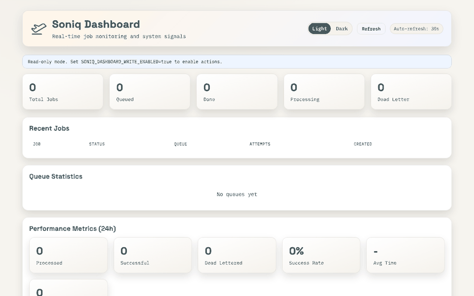

<p align="left">
  
</p>

# Soniq

Background jobs for FastAPI and any asyncio app, stored in the Postgres you already have. No Redis, no broker, nothing else to run.

- Jobs are rows in your database. They survive restarts and deploys, and they retry on failure.
- Enqueue a job in the same transaction as your business write. If the write rolls back, the job is gone too.
- Retries, scheduling, a dead-letter queue and a dashboard are in the package.

[](https://pypi.org/project/soniq/)
[](https://pypi.org/project/soniq/)
[](https://github.com/abhinavs/soniq/blob/main/LICENSE)
[](https://github.com/abhinavs/soniq/actions)

## Quickstart

```bash
pip install soniq
```

```python
# jobs.py
import asyncio
from soniq import Soniq

soniq = Soniq()

@soniq.job(name="send_welcome")
async def send_welcome(to: str):
    print(f"Sending welcome email to {to}")

if __name__ == "__main__":
    asyncio.run(soniq.enqueue(send_welcome, to="dev@example.com"))
```

```bash
export SONIQ_DATABASE_URL="postgresql://localhost/myapp"

soniq setup                              # one-time: create tables
soniq worker jobs:soniq --concurrency 4  # run a worker
python jobs.py                           # enqueue (in another terminal)
```

Four steps. Define a job, set up the database, run a worker, enqueue. `Soniq()` and the `soniq` command both read `SONIQ_DATABASE_URL`. `jobs:soniq` tells the worker where your Soniq instance is, so it finds your `@soniq.job()` functions. The `SONIQ_JOBS_MODULES=jobs` environment variable from earlier releases still works.

## Coming from FastAPI BackgroundTasks

`BackgroundTasks` runs the task inside the web process after the response is sent. If that process stops before the task finishes, for example when a deploy stops it after a short grace period, the task is lost. There are no retries.

With Soniq the task is a row in Postgres. The change is small:

```diff
-from fastapi import BackgroundTasks, FastAPI
+from fastapi import FastAPI
+from soniq import Soniq
+from soniq.integrations.fastapi import lifespan

-app = FastAPI()
+soniq = Soniq()
+app = FastAPI(lifespan=lifespan(soniq, run_worker=True))

+@soniq.job(retries=3)
 async def send_welcome(user_id: int):
     ...

 @app.post("/users")
-async def create_user(name: str, background_tasks: BackgroundTasks):
+async def create_user(name: str):
     user = await save_user(name=name)
-    background_tasks.add_task(send_welcome, user.id)
+    await soniq.enqueue(send_welcome, user_id=user.id)
     return {"id": user.id}
```

`run_worker=True` runs the worker in the same process, so you still deploy one service. When the load grows, run `soniq worker` as its own process. [examples/backgroundtasks_vs_soniq](examples/backgroundtasks_vs_soniq) restarts a server mid-send with both versions and counts the lost jobs. See the [FastAPI guide](docs/guides/fastapi.md) for details.

## Transactional enqueue

Enqueue a job inside the same transaction as your business write. If the transaction rolls back, the job never existed. With SQLAlchemy async, pass your session:

```python
async with db.begin():
    order = Order(product_id=product_id, quantity=quantity)
    db.add(order)
    await db.flush()
    await soniq.enqueue(send_invoice, connection=db, order_id=order.id)
# SQLAlchemy commits here. Workers see the job at the same moment.
```

Raw asyncpg and psycopg 3 connections work too:

```python
async with soniq.backend.acquire() as conn:
    async with conn.transaction():
        await conn.execute("INSERT INTO orders (id, total) VALUES ($1, $2)", order_id, total)
        await soniq.enqueue(send_invoice, connection=conn, order_id=order_id)
```

A Redis-backed queue cannot do this. Its writes go to a different system, so you need an outbox table and a process to drain it. Soniq's job table is in your Postgres, so one transaction covers both. See the [transactional enqueue guide](docs/guides/transactional-enqueue.md).

Soniq is at-least-once, not exactly-once. A worker can crash after it runs your handler but before it marks the row done. The heartbeat sweep then requeues the job. Write handlers so they can run again safely. See [docs/guides/cross-service-jobs.md](docs/guides/cross-service-jobs.md) for the delivery details.

## Why Soniq

Most Python job queues force you to run Redis or RabbitMQ alongside your database. That is another service to deploy, monitor, back up, and debug when things go wrong at 3am.

Soniq uses your existing PostgreSQL. One dependency. One place your data lives. One thing to back up.

| Feature                      | Soniq | Celery      | RQ     |
| ---------------------------- | ----- | ----------- | ------ |
| No Redis / broker dependency | Yes   | No          | No     |
| Async native                 | Yes   | Partial     | No     |
| **Transactional enqueue**    | Yes   | No          | No     |
| Setup complexity             | Low   | High        | Medium |
| Built-in dashboard           | Yes   | No (Flower) | No     |
| Dead-letter queue            | Yes   | No          | No     |

For a longer comparison with Celery, RQ, arq, Taskiq, and the other Postgres-backed queues, see [docs/compare.md](docs/compare.md). For numbers, see [docs/benchmarks.md](docs/benchmarks.md). For what we promise to keep stable, see [docs/stability.md](docs/stability.md).

## When NOT to use Soniq

- **You need 10k+ jobs/sec sustained throughput.** PostgreSQL row locking has limits. Redis-backed queues like Celery or Arq are built for this.
- **You need cross-language workers.** Soniq is Python-only. If your workers are in Go or Node, use RabbitMQ or similar.
- **You are not using PostgreSQL.** The production backend requires PostgreSQL.
- **You need DAG-based workflow orchestration.** Soniq runs individual jobs, not pipelines. Look at Prefect or Airflow.

## Features

- **Retries with backoff** - configurable delays, exponential backoff, per-attempt delay lists
- **Dead-letter queue** - failed jobs preserved for inspection and manual replay
- **Job priorities** - lower number = higher priority, processed first
- **Scheduled jobs** - run at a specific time or after a delay
- **Recurring jobs** - cron-based recurring schedules with `@soniq.periodic(cron="0 * * * *")`
- **Transactional enqueue** - atomic with your database writes
- **Multiple queues** - route jobs by type, run dedicated workers per queue
- **Middleware hooks** - `before_job`, `after_job`, `on_error` for logging, metrics, tracing
- **Worker heartbeat** - auto-detect crashed workers, requeue their jobs
- **Deduplication** - prevent duplicate jobs with `dedup_key` or `unique=True`
- **CLI + dashboard** - `setup`, `worker`, `scheduler`, `status`, `inspect`, dead-letter management; web UI

## Dashboard

A built-in web dashboard for inspecting jobs, queues, and recent failures. Read-only by default; opt in to retry/cancel/delete actions with `SONIQ_DASHBOARD_WRITE_ENABLED=true` (which also requires `SONIQ_DASHBOARD_API_KEY` as a safety interlock).

<p align="left">
  
</p>

```bash
pip install "soniq[dashboard]"
soniq dashboard                       # binds 127.0.0.1:6161
```

## Install extras

```bash
pip install soniq              # core + scheduler + Prometheus sink (Postgres backend)
pip install soniq[full]        # everything below
pip install soniq[dashboard]   # web dashboard (FastAPI + uvicorn)
pip install soniq[webhooks]    # webhook delivery + signing
pip install soniq[logging]     # structlog integration
pip install soniq[sqlalchemy]  # pass a SQLAlchemy session to enqueue
pip install soniq[psycopg]     # pass a psycopg 3 connection to enqueue
```

The default install is batteries-included: `croniter` (so `@periodic` and the recurring scheduler work out of the box) and `prometheus_client` (so `PrometheusMetricsSink` is importable) ship with core. They stay dormant unless wired - the scheduler only runs if you start it, and the default `MetricsSink` is `NoopMetricsSink`.

## Documentation

- [Quickstart](docs/quickstart.md)
- [Tutorial: defining jobs](docs/tutorial/01-defining-jobs.md)
- [FastAPI integration](docs/guides/fastapi.md)
- [Transactional enqueue](docs/guides/transactional-enqueue.md)
- [Compare tools](docs/compare.md)
- [Benchmarks](docs/benchmarks.md)
- [Stability and versioning](docs/stability.md)
- [FastAPI demo app](examples/fastapi_demo)
- [Going to production](docs/production/going-to-production.md)
- [Deployment](docs/production/deployment.md)
- [CLI reference](docs/cli/commands.md)
- [API reference](docs/api/soniq.md)

### For AI coding agents

- [`AGENTS.md`](AGENTS.md) - canonical patterns, anti-patterns, and the four mistakes agents most often make.
- [`docs/llms.txt`](docs/llms.txt) - curated index of the canonical pages, following the [llms.txt convention](https://llmstxt.org).
- [`docs/llms-full.txt`](docs/llms-full.txt) - the canonical pages concatenated for one-shot context loading.

## License

MIT
