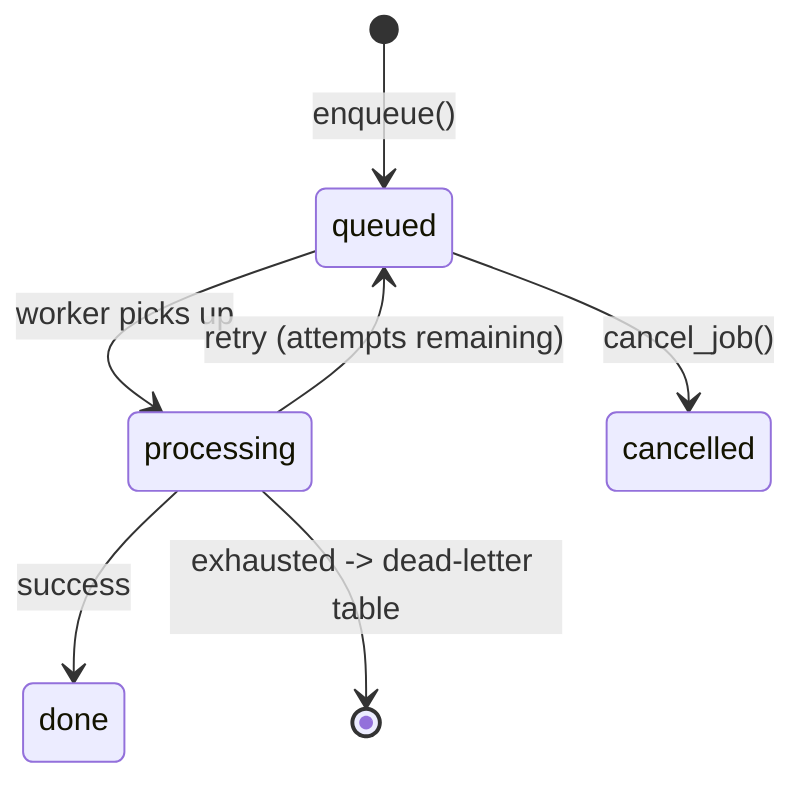

# 1. Define and enqueue background jobs in Python

> **Beginner** - 5 minutes. The decorator, enqueueing, and what a job is.

A Soniq job is a Python function that runs in the background on a worker. You define the job with the `@soniq.job()` decorator and enqueue it with arguments. A worker then claims the job from PostgreSQL and runs it.

## Defining a job

```python
from soniq import Soniq

soniq = Soniq(database_url="postgresql://localhost/myapp")

@soniq.job(name="users.send_welcome_email")
async def send_welcome_email(user_id: int, template: str = "default"):
    user = await get_user(user_id)
    await send_email(user.email, template)
```

The `@soniq.job()` decorator registers the function with Soniq. The function stays a normal `async def`. You can call it directly in tests, or enqueue it as a background job.

`name=` is the *task name*. Soniq stores it in each job row and uses it to find the handler again. If you leave it out, Soniq derives a name from the module path (`myapp.tasks.send_welcome_email`). That behavior is deprecated since 0.2.0 and prints a warning. Always set the name yourself.

## Enqueuing a job

```python
job_id = await soniq.enqueue(send_welcome_email, user_id=42)
```

`enqueue` writes a row into the `soniq_jobs` table. The next free worker claims the row, runs `send_welcome_email(user_id=42)`, and marks the row done.

Note these points:

- `enqueue` is a coroutine. You must `await` it. If you forget, Python warns `RuntimeWarning: coroutine was never awaited`.
- Job arguments are keyword-only. Write `user_id=42`, not `enqueue(send_welcome_email, 42)`. Keyword arguments keep stored jobs valid when you reorder the parameters of your function.
- `enqueue` returns a job id. Use the id later to check the status or to cancel the job.

You can also call `.enqueue()` on the job function itself:

```python
job_id = await send_welcome_email.enqueue(user_id=42)
```

This does the same as `soniq.enqueue(send_welcome_email, user_id=42)`. A type checker such as mypy or pyright checks the arguments against the function signature. Soniq supports both forms. `soniq.enqueue(...)` is not deprecated. See [job.enqueue() and job.options()](../api/jobs.md#jobenqueue-and-joboptions).

## Job status lifecycle

Every enqueued job is in one of these states:



You can check a job's status at any time:

```python
job = await soniq.get_job(job_id)
print(job["status"])   # "queued", "processing", "done" or "cancelled"

result = await soniq.get_result(job_id)  # return value of a completed job
```

The "exhausted" arrow points to the **dead-letter queue**. This is a separate table, `soniq_dead_letter_jobs`, that holds jobs that failed every retry. You can inspect these jobs and replay them. [Chapter 3](03-retries.md) covers retries.

### Managing jobs

```python
await soniq.cancel_job(job_id)    # cancel a queued job
await soniq.delete_job(job_id)    # remove a job entirely
await soniq.list_jobs(queue="billing", status="queued", limit=20)
```

To run a job again after it used all its retries, replay it from the dead-letter table:

```python
new_job_id = await soniq.dead_letter.replay(job_id)
```

## Going further

The rest of this page covers features you can read later. The sections above are enough for the next chapters.

### Decorator options at a glance

`@soniq.job()` accepts these optional parameters: `timeout`, `priority`, `queue`, `unique`, the retry settings, and `validate`. Later chapters explain each one. The [Jobs API reference](../api/jobs.md) has the full list.

Always write the parentheses: `@soniq.job()`. The bare form `@soniq.job` is not supported.

### Task names across services

An explicit name lets you rename or move the function without breaking jobs already in the queue. This matters most when the producer and the consumer are in different codebases:

```python
@soniq.job(name="users.send_welcome_email")
async def send_welcome_email(user_id: int, template: str = "default"):
    ...
```

The producer can then enqueue the job by string name, without importing the consumer's code:

```python
await soniq.enqueue("users.send_welcome_email", args={"user_id": 42})
```

A typed `TaskRef` form also exists. See [cross-service jobs](../guides/cross-service-jobs.md).

### Per-enqueue overrides

You can override decorator defaults at enqueue time:

```python
job_id = await soniq.enqueue(
    send_welcome_email,
    user_id=42,
    priority=1,          # override priority for this run
    queue="urgent",      # route to a different queue
    unique=True,         # deduplicate this specific enqueue
)
```

With the job handle, put the overrides in `.options()`:

```python
job_id = await send_welcome_email.options(
    priority=1, queue="urgent", unique=True
).enqueue(user_id=42)
```

### JobContext: runtime metadata in your handler

Add a parameter with the type `JobContext`. Soniq then passes in metadata about the running job: id, attempt number, worker, and queue.

```python
from soniq import JobContext

@soniq.job(name="billing.process_invoice")
async def process_invoice(invoice_id: str, ctx: JobContext):
    print(f"Job {ctx.job_id}, attempt {ctx.attempt} of {ctx.max_attempts}")
```

Use it for logging, tracing, and logic that depends on the retry attempt. Do not pass it when you enqueue. The [Jobs API reference](../api/jobs.md#jobcontext) lists all fields.

### Argument validation with Pydantic

Pass a Pydantic model as `validate=`. Soniq then rejects bad arguments when you enqueue, not later in a worker:

```python
from pydantic import BaseModel

class EmailArgs(BaseModel):
    user_id: int
    template: str = "default"

@soniq.job(name="users.send_welcome_email", validate=EmailArgs)
async def send_welcome_email(user_id: int, template: str = "default"):
    ...

# Raises SoniqError at the call site. The job is not enqueued.
await soniq.enqueue(send_welcome_email, user_id="not_an_int")
```

### Transactional enqueue (preview)

You can enqueue a job inside the same database transaction as your business write. If the transaction rolls back, Soniq does not create the job.

```python
await soniq.ensure_initialized()   # soniq.backend is None until this runs
async with soniq.backend.acquire() as conn:
    async with conn.transaction():
        await conn.execute("INSERT INTO orders ...")
        await soniq.enqueue(send_welcome_email, connection=conn, user_id=42)
```

[Chapter 6](06-transactional-enqueue.md) covers this pattern in full.

## Next steps

Continue with [chapter 2: running workers](02-running-workers.md).
